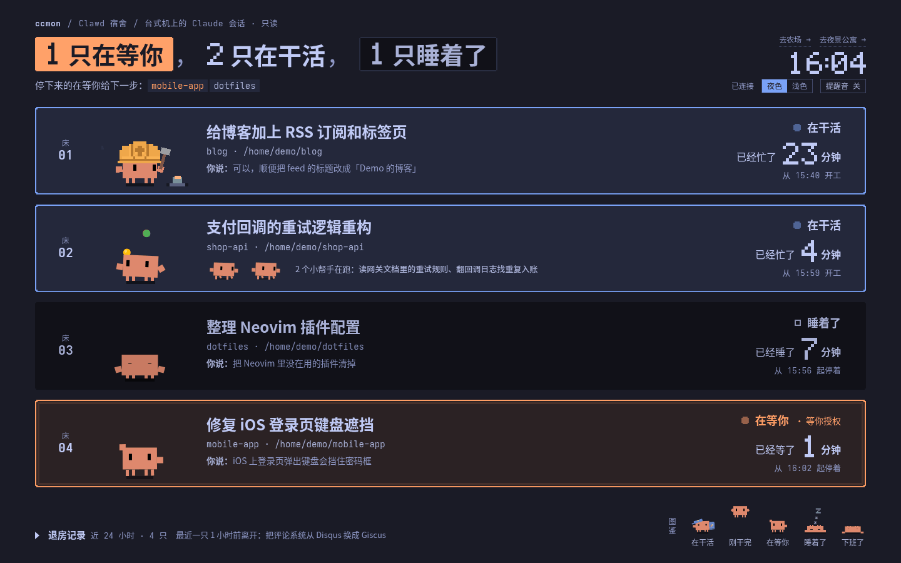
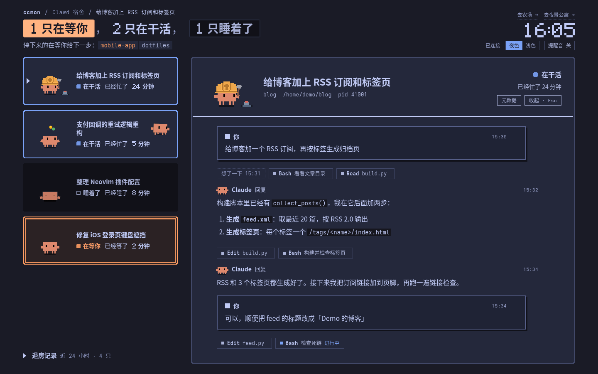
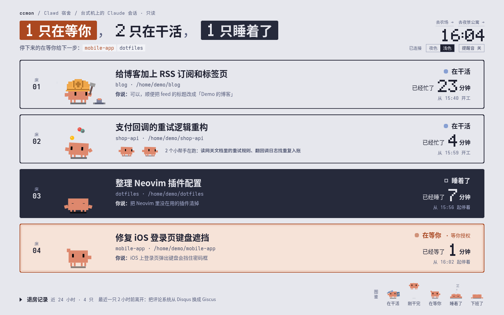
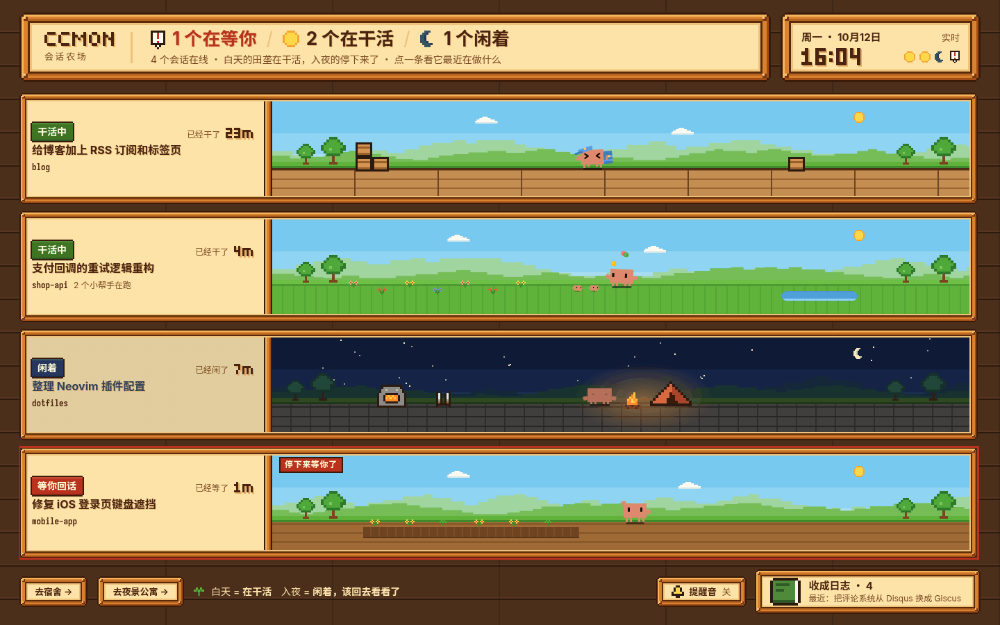
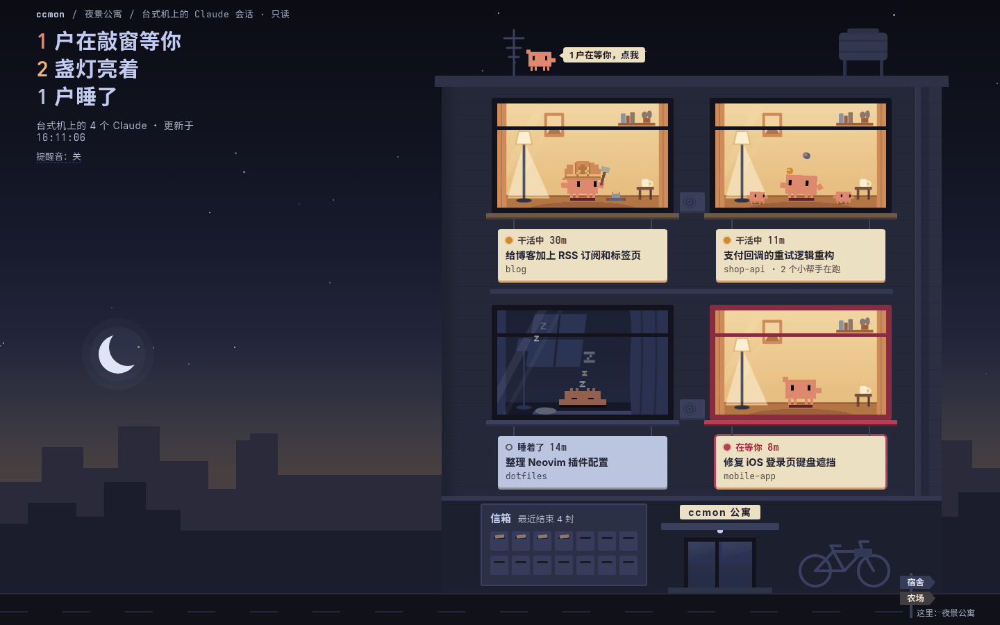

# ccmon · Claude Code 会话监控站

在旁边的另一台电脑（或手机、平板）上，用浏览器实时盯着这台机器上**所有** Claude Code 会话：
谁在干活、谁停下来了、谁在等你授权——一眼就知道该不该回去看。点进任意一个会话，能看到它完整的对话流。

*A tiny LAN dashboard that shows every Claude Code session on your machine as a pixel Clawd: working, idle, or waiting for you. Read-only, zero dependencies (Python stdlib).*



## 能看到什么

- **状态一眼可辨**：每个会话是一只 [Clawd](https://github.com/rullerzhou-afk/clawd-on-desk)（Claude Code 的像素小螃蟹）。
  干活时它在敲键盘 / 搭积木 / 搬箱子；闲下来先打哈欠、再打盹、久了趴下睡死；等你授权时举手喊你。
  带着子代理时它戴耳机摇摆，子代理多了就抛球。
- **完整时间线**：你说的话、Claude 的回复、思考、每次工具调用的参数和结果（Edit 显示成 diff），实时追加。
  长串工具调用自动折叠；每条都能点开看原始 JSON；子代理和最近 24 小时结束的会话也能点开。
- **提醒**：会话忙完（忙了 20 秒以上才算）或停下来等你时响一声；标签页小图标跟着变（醒着 / 睡了 / 红点）。
- **只读**：只看，不会往会话里发任何东西。

## 三个主题

页面角落可以随时切换，浏览器会记住上次用的。

| 地址 | 主题 | 在干活 / 闲着 |
|---|---|---|
| `/cats` | **Clawd 宿舍**（默认，Tokyo Night 夜色，可切浅色） | 床位亮着 / 熄灯下沉 |
| `/farm` | **像素农场** | 白天干活 / 入夜在篝火边打盹 |
| `/night` | **夜景公寓** | 窗户亮暖灯 / 灭灯睡觉 |

| 宿舍 · 详情 | 宿舍 · 浅色 |
|---|---|
|  |  |
| **像素农场** | **夜景公寓** |
|  |  |

> 截图用的是 `scripts/demo.py` 编出来的假会话。

## 快速开始

需要：Python 3.9+、跑着 Claude Code 的那台机器（Linux / macOS）。不需要装任何 Python 包。

```sh
git clone https://github.com/numb747/ccmon.git
cd ccmon
./scripts/fetch-assets.sh        # 下载 Clawd 动画和提示音（不随仓库分发，见下文）
python3 app.py                   # 默认监听 0.0.0.0:18767
```

第一次启动会生成访问密码，打印在终端里（也存在 `./.password`）。然后在另一台设备上打开 `http://<这台机器的内网 IP>:18767/`，输一次密码，浏览器会记住一年。

**只想先看看长什么样？** 不用装 Claude Code：

```sh
python3 scripts/demo.py          # 用假数据跑一份，打开 http://127.0.0.1:18799/
```

### 开机自启（systemd 用户服务）

```sh
mkdir -p ~/.config/systemd/user
cp contrib/ccmon.service ~/.config/systemd/user/   # 里面的路径按你的 clone 位置改一下
systemctl --user daemon-reload
systemctl --user enable --now ccmon
journalctl --user -u ccmon -f                       # 看日志：首次生成的密码、登录、输错密码
```

## 安全说明（请读）

- **会话内容很敏感**：时间线里有工具的完整输出，你读过的配置文件、环境变量、密钥都可能出现在里面。
- 访问控制是**防君子不防小人**的一道密码：明文存在 `.password`，HTTP 不加密。适合家里或办公室内网，**不要暴露到公网**。
  要从外面看，请放在 VPN / Tailscale / 带 HTTPS 和认证的反向代理后面。
- 改密码：直接改 `.password` 文件，不用重启；改完所有设备都要重新登录。
- 本机自己访问（127.0.0.1 或本机 IP）免密码。
- 输错密码会延迟 1 秒再返回，登录和失败都会记日志。

## 它是怎么拿到数据的

不改 Claude Code 的任何配置，也不装 hook，只读本地文件：

| 数据 | 来源 |
|---|---|
| 有哪些会话、在跑还是在等你 | `claude agents --json`（每 2 秒一次）+ `~/.claude/sessions/<pid>.json` |
| 对话全文 | `~/.claude/projects/<项目>/<sessionId>.jsonl`，按字节偏移增量读取，SSE 推给浏览器 |
| 子代理 | 同目录下的 `<sessionId>/subagents/agent-*.jsonl` |

⚠️ transcript 是 Claude Code 的**内部格式**，官方说明会随版本变化。解析不认识的条目会原样降级显示，每条都能看原始 JSON，所以升级后最多是某些内容显示得不好看，不会丢信息。出问题时改 `app.py` 里的 `parse_line`。

## 文件

| 路径 | 说明 |
|---|---|
| `app.py` | 后端：HTTP 服务、密码、transcript 解析和增量推送 |
| `ccstatus.py` | 会话状态判据（在跑 / 刚完成 / 空闲 / 等你 / 已退出） |
| `cats.html` / `farm.html` / `night.html` | 三个主题，各自单文件，改完刷新浏览器即可 |
| `index.html` | 入口，跳到上次用的主题 |
| `index-v1.html` | 最早的开发者风格界面，`/v1` |
| `assets/clawd/clawd.js` | 三个主题共用：会话状态 → Clawd 用哪个动画、取景 |
| `assets/ccmon/alert.js` | 三个主题共用：提示音、标签页图标、登录过期跳转 |
| `scripts/fetch-assets.sh` | 下载第三方素材 |
| `scripts/demo.py` | 用假数据跑一份演示 |
| `contrib/ccmon.service` | systemd 用户服务示例 |

## 素材与许可

- 本仓库的代码以 **MIT** 许可发布，见 [LICENSE](LICENSE)。
- **Clawd 的动画 svg 和提示音不在本仓库里**，由 `scripts/fetch-assets.sh` 从
  [rullerzhou-afk/clawd-on-desk](https://github.com/rullerzhou-afk/clawd-on-desk) 下载（该项目以 AGPL-3.0 发布；
  完成提示音 `complete.mp3` 为 CC0，来自 Freesound 用户 iut_Paris8）。
- Clawd 形象是 Anthropic 的 Claude Code 吉祥物。本项目与 Anthropic 无关。
- 感谢 clawd-on-desk 把 Clawd 做成了一整套会动的状态动画。
